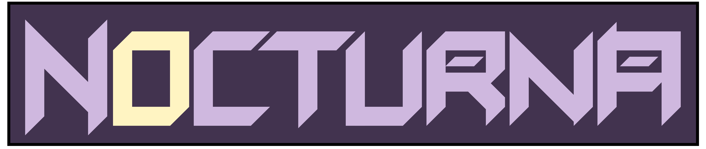

Nocturna is a UTSA ECE Capstone project developing a quadruped robot for autonomous nocturnal wildlife monitoring. This repository will function as our Design Package documentation.

## Structure    

```text
Nocturna/                          
├── DesignPackage.pdf                     
|
├── absolute_review_slides_JC/
|   └── slides_final.pptx
|
├── additional_documentation_NF/
|   └── imgs/
|
├── CAD_folder_LL/
|   └── CAD_Design_Package_.pdf                  
|            
├── component_folder_JC/
|   └── Component_Design_Package_.pdf 
|
├── schematic_folder_DT/                        
|   └── Schematic_Design_Package_DT.pdf    
|
└── software_folder_NF/
    └──  Software_Outline_Design_Package_RN.md
        
```

## Contributors

* [Nicolas Frey](https://github.com/MakerFrey)
* [Derrick Tong](https://github.com/DerrickT0ng)
* [Lawrence Lee](https://github.com/Lawrence850479)
* [Roberto Navajiro](https://github.com/robertonava08)
* [Jack Crawford](https://github.com/jcrawford14200)
