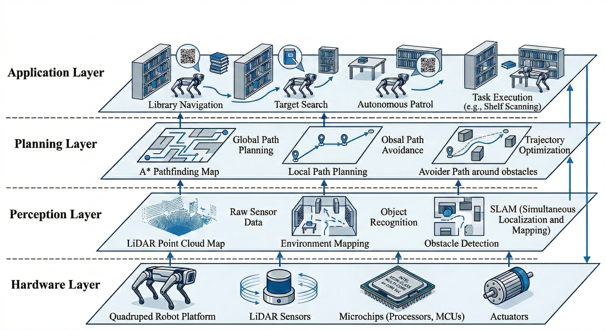

# Software Outline

The software folder of the Nocturna Design Package documentation organizes our software components to best highlight its architecture design while also providing descriptions of critical functions and variables as they are mapped into the ROS 2 Framework design philosophy.

## Architecture

Figure: Architectural visualization of the software layers. From Li et al (2026). "Autonomous Navigation System for Library Service Robot Based on Unitree Go2 Edu."  [https://doi.org/10.48550/arXiv.2606.03340]

## Software Packages

| Project Objective | Proposed ROS 2 Package | Core Responsibility |
| :--- | :--- | :--- |
| SLAM | `nox_SLAM` | Mapping, localization, and map management |
| Heatmap | `nox_heatmap` | Wildlife activity heatmap generation |
| Autonomy | `nox_autonomy` | Exploration, navigation, and mission planning |
| User Communication | `nox_communication` | User commands, system status, and visualization |
| Wildlife Detection & Classification | `nox_wildlife_detection` | Wildlife recognition and classification |
| Data Collection & Documentation | `nox_data_logging` | Recording, organizing, and retrieving collected data |

---

## 1. SLAM

| Proposed File | Description |
| :--- | :--- |
| `slam_manager.cpp` | Coordinates the SLAM process and monitors mapping and localization status |
| `map_manager.cpp` | Handles saving, loading, and managing previously generated maps |
| `localization_manager.cpp` | Manages localization against an existing map and reports localization status |
| `slam.launch.py` | Launches the selected SLAM software and its supporting nodes |
| `slam_params.yml` | Stores SLAM configuration parameters |

---

## 2. Navigation

| Proposed File | Description |
| :--- | :--- |
| `mission_manager.cpp` | Coordinates autonomous missions and transitions between operating modes |
| `exploration_manager.cpp` | Selects unexplored areas for autonomous exploration |
| `navigation_manager.cpp` | Sends navigation goals to the navigation system and monitors their execution |
| `obstacle_monitor.cpp` | Monitors obstacles and navigation hazards using available sensor data |
| `return_manager.cpp` | Coordinates returning to a designated starting location or previously mapped area |
| `autonomy_params.yaml` | Stores exploration, navigation, and mission configuration parameters |

---

## 3. Heatmap

| Proposed File | Description |
| :--- | :--- |
| `heatmap_generator.cpp` | Generates wildlife activity heatmaps using recorded sighting locations |
| `sighting_aggregator.cpp` | Groups and processes wildlife detections by location and frequency |
| `heatmap_manager.cpp` | Manages heatmap generation, updates, and retrieval |
| `heatmap_params.yaml` | Defines heatmap resolution, spatial boundaries, and other settings |

---

## 4. Interface

| Proposed File | Description |
| :--- | :--- |
| `command_handler.cpp` | Receives and processes user commands, such as starting or stopping a mission |
| `status_publisher.cpp` | Publishes robot status, mission progress, and system information |
| `data_interface.cpp` | Provides access to generated maps, heatmaps, and wildlife records for the user interface |
| `communication_params.yaml` | Defines communication settings and interface parameters |

---

## 5. Observation

| Proposed File | Description |
| :--- | :--- |
| `wildlife_detector.cpp` | Processes camera images to identify potential wildlife |
| `wildlife_classifier.cpp` | Determines the animal category or species using a trained classification model |
| `detection_manager.cpp` | Coordinates detection results, confidence thresholds, and event publication |
| `wildlife_localizer.cpp` | Associates wildlife detections with positions in the robot's map |
| `detection_params.yaml` | Stores model settings, confidence thresholds, and detection parameters |

---

## 6. Data

| Proposed File | Description |
| :--- | :--- |
| `data_logger.cpp` | Records wildlife sightings and relevant mission data |
| `sighting_recorder.cpp` | Stores detection records, images, timestamps, classifications, and locations |
| `database_manager.cpp` | Manages storage and retrieval of recorded wildlife information |
| `mission_report.cpp` | Generates summaries of completed exploration missions |
| `logging_params.yaml` | Configures data storage paths, logging settings, and recording options |

---

## 7. Launch Packages

| Proposed File | Description |
| :--- | :--- |
| `system.launch.py` | Launches the complete Nocturna software system |
| `sensors.launch.py` | Starts the required sensor drivers and interfaces |
| `robot.launch.py` | Starts the Unitree robot interface and required robot-side components |
| `system_params.yaml` | Stores shared system configuration parameters |